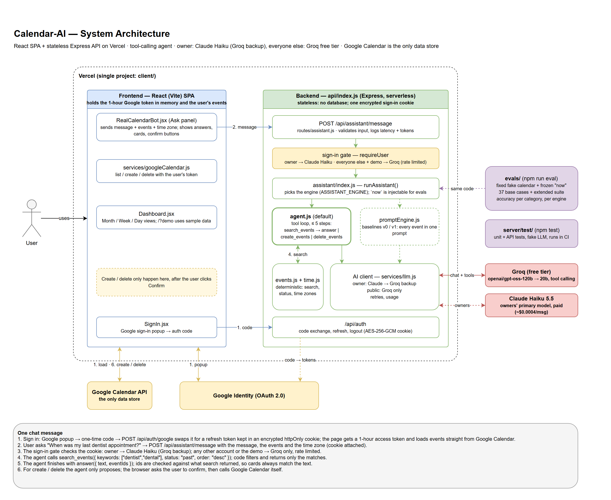

# Calendar-AI

**Chat with your Google Calendar.** Ask "when was my last dentist appointment?" or type "gym Friday at 6pm".
A tool-calling AI agent answers from your real calendar, and every change waits for your confirmation.

[](https://github.com/derko510/Calendar-AI/actions/workflows/ci.yml)

**Try it without signing in:** [derricks-calendar-ai.vercel.app/?demo](https://derricks-calendar-ai.vercel.app/?demo) (sample calendar; the demo chat runs on a free AI tier with a daily limit).



## What it does

- **Answers questions** about past and upcoming events: "what's next?", "what did I do last weekend?", "when am I flying to New York?"
- **Adds events from plain English**, typos included: "meeting w prof tmrw at 3", "party Friday 10pm to 1am".
- **Deletes events** after showing you exactly which ones and asking you to confirm.
- **A full calendar UI**: month, week and day views, drag to create, edit, RSVP, guest notifications, calendar toggles, keyboard shortcuts, and a phone layout.

## How it works

1. The browser signs in with Google and loads events **straight from Google Calendar**. There is no database.
2. A chat message goes to one serverless API route with the events and your time zone.
3. The **agent** asks the model what to do. The model calls a tool, `search_events`, with filters (keywords, past/now/upcoming, a date range).
4. **Plain code** runs that search in your time zone and returns only the matching events.
5. The model finishes with an answer, or proposes a create or delete.
6. Creates and deletes are **proposals**. The browser shows a Confirm button, and only your click writes to Google.

The model decides *what to look for* and *how to phrase the answer*. Code does all the date and time logic.

## Measured results

The same questions are run against a fixed fake calendar with a frozen clock, and graded by code (no AI judge).

| Version | Model | Original 37 cases | 20 harder cases | Median response |
|---|---|---|---|---|
| **Agent (current)** | Claude Haiku 5.5 | **36–37 / 37** over 5 runs | **20 / 20** on every run | 1.8 s |
| **Agent (current)** | Groq `gpt-oss-120b` (free) | **37 / 37** (1 full run) | 19 / 20 | 0.8 s |
| Single prompt with current time | Claude Haiku 5.5 | 34 / 37 (1 run) | not run | 1.4 s |
| Single prompt, original design | Claude Haiku 5.5 | 28 / 37 (1 run) | not run | 1.6 s |

What the numbers mean, and their limits:

- The original design pasted every event into one prompt. Asked "what's next?" at 5:27 PM, it returned a 1:30 PM meeting that had already ended. That bug is why the agent exists.
- Before the Groq fixes the same free model scored 32 / 37 and the smaller `gpt-oss-20b` scored 19–24 / 37, mostly from malformed tool calls. After them: zero malformed calls on the measured runs.
- The harder suite covers follow-up questions, several events in one message, overnight events, relative dates ("this weekend"), ambiguous deletes, a non-US time zone, a 300-event calendar, and an event title that tries to give the model instructions.
- 57 cases is a small suite on one synthetic calendar, and the prompt was tuned on the original 37. The one recurring miss is an ambiguous question ("when did I last see the doctor?" when the most recent visit was a dental checkup).
- Groq's free tier allows 200,000 tokens per model per day, so some Groq runs could not be repeated the same day.

## Design decisions

- **An agent with tools, not one big prompt.** Models are unreliable at date arithmetic; code is exact. Cost also stays flat as the calendar grows, because only search results reach the model.
- **No vector database.** Calendar questions depend on time and exact names. Date filters plus a small synonym list ("dentist" also matches "dental") do the job with no extra infrastructure.
- **The AI proposes, the user confirms.** Deletes are limited to events the agent found by searching, so a guessed id or a malicious invite cannot change the calendar.
- **Stateless server.** One encrypted cookie is the only per-user state. Nothing to back up or leak.
- **Two AI tiers.** The owner's accounts get Claude Haiku 5.5 (about $0.0005 per message). Everyone else, and the demo, get Groq's free tier only and are rate limited, so visitors cannot spend the owner's money.

## Security model

- Google authorization-code sign-in. The refresh token is encrypted with AES-256-GCM in an httpOnly cookie; page JavaScript never sees it. The page holds a 1-hour access token in memory only.
- The chat route requires a session (or the demo flag) and decides the AI tier from the signed-in email.
- Auth routes require a custom header and an exact-match origin list; the cookie is SameSite=Lax.
- Calendar text is treated as untrusted: only http and https links become clickable, and HTML is parsed to text.
- The server never logs message text, event text, emails, tokens or keys.

## Run it locally

```bash
cd client
npm install
cp .env.example .env     # fill in the Google client and at least one AI key
npm run check-env        # checks every setting without printing secrets
npm run dev:api          # API on http://localhost:3001
npm run dev              # app on http://127.0.0.1:5173
```

Details: [setup.md](setup.md) for local setup, [DEPLOYMENT.md](DEPLOYMENT.md) for Vercel.

## Tests and evals

```bash
npm test                              # 163 unit tests, fake AI, no network
npm run lint
npm run eval -- --dry                 # validate eval cases offline
npm run eval -- --model claude-haiku-5-5        # live accuracy run (costs about $0.03)
npm run eval -- --engine all --suite core       # compare the agent with the single-prompt baselines
```

CI runs lint, the unit tests, the offline eval checks and the build on every push. See [client/evals/README.md](client/evals/README.md).

## Limits and next steps

- Chat memory is the last few turns in the open tab; nothing is stored across reloads or devices.
- No recurring-event create or whole-series edit, no drag to move or resize, no reminders, no search box.
- The visitor rate limit is in memory, so it is best effort per server instance.
- Evals: more cases, a held-out set, several runs per model, more time zones.

## More

- [documentation.md](documentation.md): a full walkthrough of the system and the decisions behind it.
- [docs/system-design.md](docs/system-design.md): the design document.

MIT licensed.
