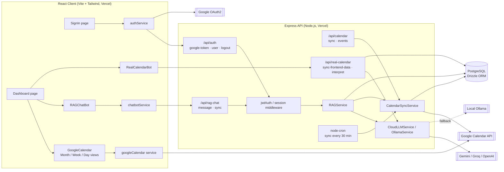
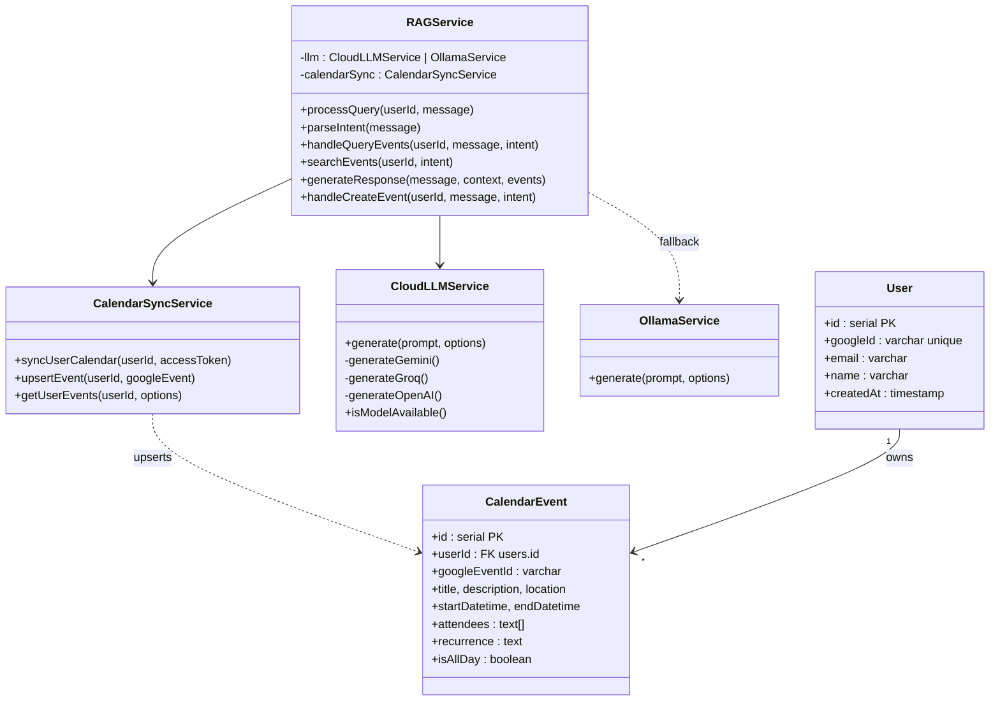
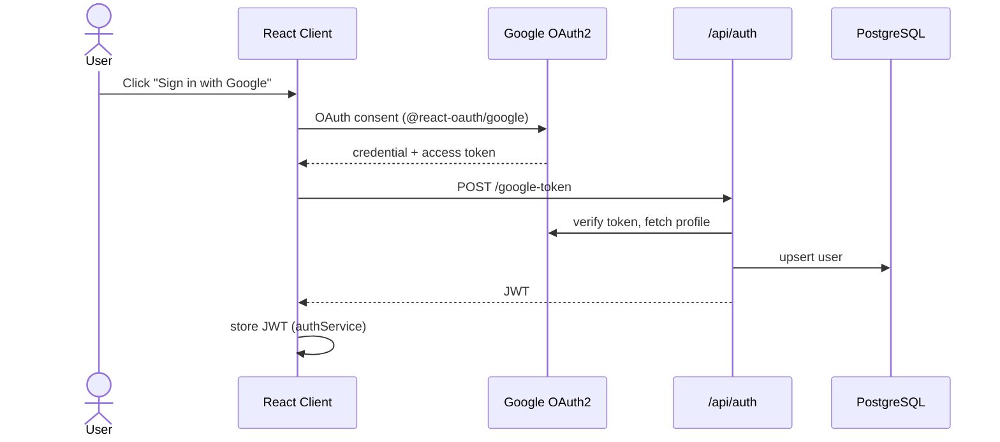
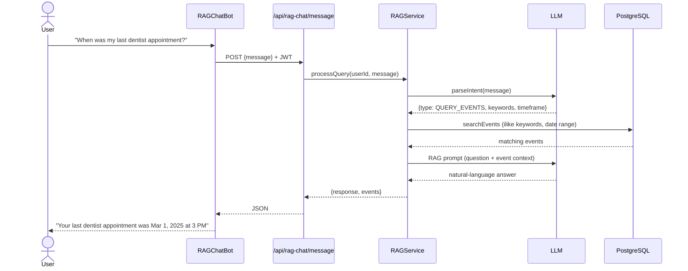
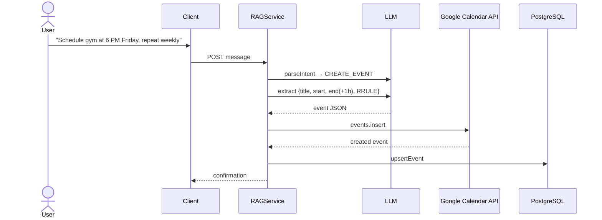
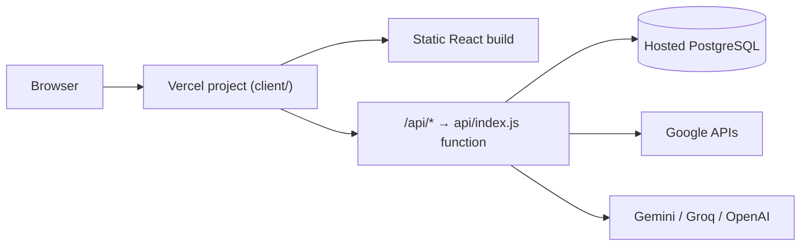

# Calendar AI — System Design (UML)

All diagrams are Mermaid and render on GitHub.

## 1. Component Diagram

## 2. Class Diagram

## 3. Sequence — Login

## 4. Sequence — Ask a question (RAG)

## 5. Sequence — Create an event

## 6. Deployment

